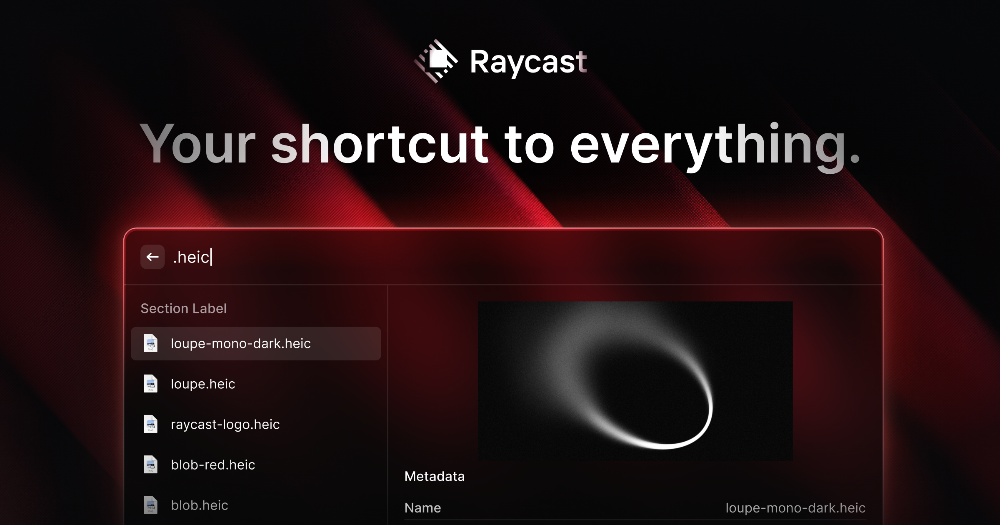
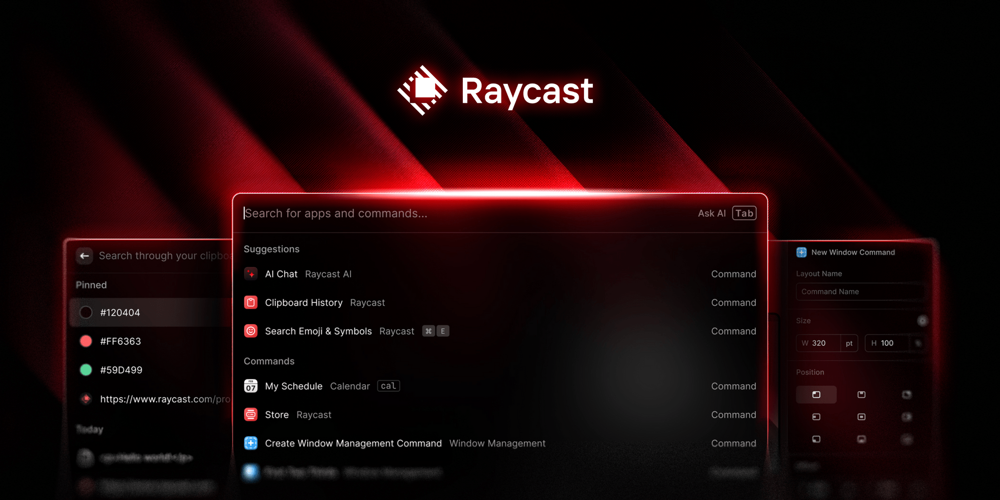
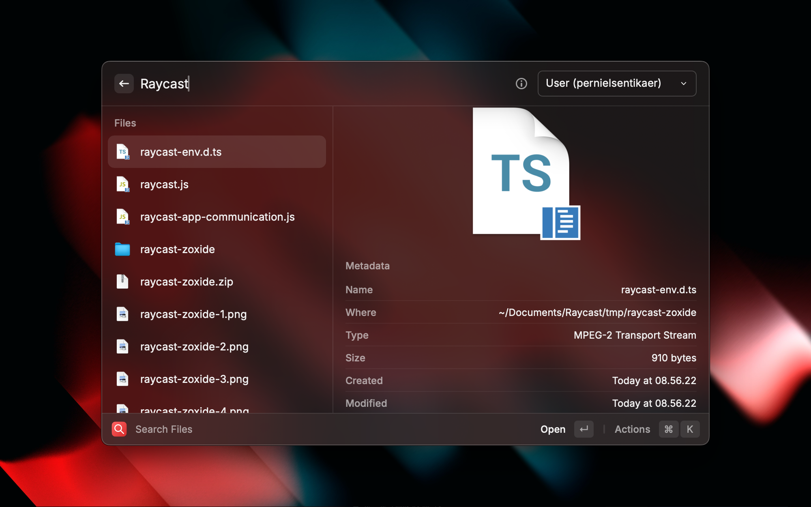

# Raycast

Raycast is a keyboard-first launcher and command bar. You press the hotkey, type a few letters, and open an app, a file, or a command without hunting through menus.

It runs on macOS, Windows, and iOS. raycast windows is the Windows build of that same bar. The iOS app is the phone side. This page does not cover a game-engine ray.

People also search Raycast Unity and Raycast Unity 3d. Those words usually mean a physics ray inside a game engine. That is a different tool. This page is the productivity launcher.

## Features

- Open applications, search local files, and run system commands.
- Clipboard history, text snippets, a calculator, window management, and an emoji picker.
- raycast ai for chat, short answers, custom agents, and voice dictation.
- raycast extensions for GitHub, Notion, Slack, Linear, and VS Code.
- A free plan and a Pro plan. Teams and Enterprise add shared workflows.

| Plan | What you get |
| --- | --- |
| Free | Core tools, clipboard history, file search, up to 5 notes, no AI |
| Pro | AI credits, cloud sync, unlimited notes, voice dictation. $8 a month billed annually, or $10 monthly |
| Teams and Enterprise | Shared workflows, a private extension store, admin and security controls |

The search box is [search.tsx](search.tsx). File results are [FileSearch.ts](search/FileSearch.ts). A single hit in the list is [ResultViewModel.cs](search/ResultViewModel.cs).

The launcher banner is the bar after the hotkey: one field, a short list, and the command you are about to run. It is not a physics diagram.

Earlier queries sit in [QueryHistory.cs](search/QueryHistory.cs). One history row is `HistoryItem.cs`.

Snippets expand from the same field. Type the short form you saved, and the bar offers the long text. Clipboard history is the list of things you copied, not a second editor. Pick a row and it pastes. The free plan includes that history. It does not include AI.

Window management commands sit in the same list as apps. Use them to move or focus a window without leaving the keyboard. If a command is missing, it may be an extension you have not turned on.

## Settings

The hotkey, the theme, and which extensions are on live in settings. Change the hotkey there if the bar opens on a key you already use for something else.

The settings screen is [settings.tsx](settings/settings.tsx). The stored preferences are [Settings.cs](settings/Settings.cs). The window that holds those pages is `SettingWindowViewModel.cs`.

Notes on the free plan stop at five. A sixth note is a Pro feature, along with cloud sync. Do not expect the free notes to appear on a second computer unless you are on Pro. Clipboard history and file search stay on the free plan.

Dictation is Pro. The publisher names that voice path Whisper. Type if you are on the free plan. The chat box is not a hidden free tier.

Custom agents are also part of raycast ai, not a separate app. An agent is a saved way to ask. It still spends Pro credits. The free plan does not include that chat.

Free accounts get five notes. Pro removes that cap and adds cloud sync. AI is not on the free plan. Dictation is a Pro feature and uses the voice path the publisher calls Whisper. The chat can talk to more than one model provider, including OpenAI, Anthropic, Claude, and Gemini. This page does not rank those providers.

## Extensions

raycast extensions are add-ons from the store. Thousands of them are community built. A store item for Notion or Slack does not replace that product. It runs a command against it from the bar.

The plugin row is [PluginViewModel.cs](plugin/PluginViewModel.cs). A store card is [PluginStoreItemViewModel.cs](plugin/PluginStoreItemViewModel.cs). A web search command is [WebSearchExtension.ts](plugin/WebSearchExtension.ts).

An extension can ask for access to a tool you already use. Read that prompt. A Notion command needs your Notion account. A Slack command needs Slack. The launcher does not invent those logins.

Keep the public store and a private team store separate. A command you wrote for your team is not automatically listed for everyone.

A GitHub, Notion, Slack, Linear, or VS Code command is still an extension. It shows up when that extension is installed and enabled. Searching the tool's name does nothing until the extension is on.

Emoji and the calculator are built in. You do not install them from the store. If the calculator does not answer, type a plain sum, not a sentence.

Window commands and file search can look alike in a short list. Read the subtitle on the row before you press Enter. Opening a file and moving a window are different jobs.

Teams can keep a private extension store. That is not the public store. Do not paste a private extension into a public list.

## Take the launcher

One launcher. Pick macOS, Windows, or iOS. One button for the publisher build.

### First look

Press the hotkey. Type the first letters of an app you use every day. Open it from the list. Then try a sum in the calculator and a paste from clipboard history.

The main window model is [MainViewModel.cs](MainViewModel.cs). The first-run screen is `WelcomeViewModel.cs`. The calculator command is [Calculator.ts](calc/Calculator.ts).

Try a snippet next. If you have not saved one, the list will not invent it. Snippets are text you stored. Notes are the longer items, capped at five on the free plan.

## Hotkeys

The launcher is useless if the key is hard to reach. On a Mac, many people want Command-Space, the key Spotlight already uses. You set that in the launcher's own hotkey settings, and you turn off or change the system shortcut that already owns that key. This page does not click through the system pane for you.

On Windows, pick a shortcut that does not fight the key you use for the Start menu. raycast windows uses the same idea: one shortcut, then the bar.

The command editor is the hotkey field: the keys you hold, and the command that should run. One shortcut for the bar. Do not stack a second global key on the same chord.

The hotkey page is [SettingsPaneHotkey.xaml.cs](hotkey/SettingsPaneHotkey.xaml.cs).

## Known issues

A file search that returns nothing is often a permission or an index, not a broken bar. Grant the file access the platform asks for, then search again.

If the bar never appears, the hotkey is probably taken. Change it before you reinstall.

AI that refuses a prompt is a credit or a plan limit. The free plan does not include raycast ai. Pro is the plan that adds credits.

## Plugins

Extensions and built-in commands share the same list. A calculator answer, a snippet, and a Slack command can show together. Read the label so you run the one you meant.

How a search engine is described is `WebSearchEngine.ts`. A suggestion under that search is `Suggestion.ts`. The plugin list page is [SettingsPanePlugins.xaml.cs](plugin/SettingsPanePlugins.xaml.cs).

The extension grid is the store in rows: name, what it talks to, and whether it is on. Turn off a row you do not use. A long list of enabled commands makes the bar noisy.

## Questions/Suggestions

Questions about a missing file result or a hotkey that does nothing belong with the publisher. This page is not a ticket desk.

A pinned or frequent hit is [TopMostRecord.cs](launcher/TopMostRecord.cs). The last thing you opened is `LastOpenedHistoryResult.cs`.

## New Changes

This page does not pin a version. The publisher site is where v2 and the current build are described. An old screenshot can show a command that has moved.

Pro pricing on this page is the figure from the current brief: $8 a month when billed annually, or $10 month to month. If the store shows another number, the store is the one to trust.

## Contributing

The bar itself is a publisher app. Extensions in the public store are the part the community writes. A private team store is not a place to publish someone else's notes.

The general settings page is [SettingsPaneGeneral.xaml.cs](settings/SettingsPaneGeneral.xaml.cs). The store page is `SettingsPanePluginStore.xaml.cs`.

How a search engine is described is [WebSearchEngine.ts](plugin/WebSearchEngine.ts). A suggestion under that search stays in the list beside it.

## Related Questions

### What is Raycast used for?

It is used as a command bar. You open apps, search files, run system commands, recall clipboard items, expand snippets, calculate, manage windows, pick emoji, and call raycast extensions. raycast ai adds chat, short answers, custom agents, and voice dictation on Pro.

### How to set Raycast to command space?

Set the launcher hotkey in its own settings to Command-Space, and free that key from the system shortcut that already uses it. The bar only appears on the key it owns. On Windows, assign a shortcut the same way instead of assuming Command-Space exists.

### Does Roblox use raycasting?

Roblox games can use raycasts in that engine. That is a game-world query, not this launcher. Raycast Unity and Raycast Unity 3d are the same kind of mix-up: a physics ray in a game engine. This page does not document those APIs.

### How do I delete Raycast?

Remove the app the way you remove other apps on that platform: the Applications list on a Mac, installed apps on Windows, or the home screen on iOS. The free plan's notes stay on the device until the app is gone. Pro cloud sync is a separate copy, and this page does not promise that deleting the app erases it.

## Related Search Terms

Raycast Unity 3d, Raycast Unity, raycast ai, raycast extensions, raycast windows, Topics: launcher, productivity, macos, windows, extensions, clipboard, search, keyboard, command-palette, typescript, snippets, spotlight
